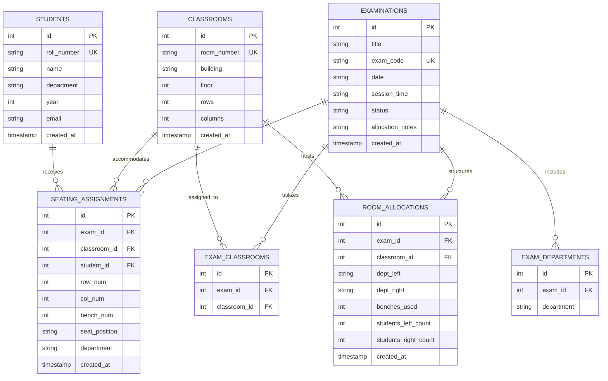

# Database Design & Schema Specification

ExamFlow employs an embedded **SQLite relational database** (`examflow.db`), adhering to Boyce-Codd Normal Form (BCNF) principles with strict referential integrity constraints (`PRAGMA foreign_keys = ON`).

---

## 1. Entity-Relationship (ER) Diagram

---

## 2. Table Data Dictionaries

### 2.1 Table: `students`
Stores individual registered student records across departments.

| Column | Type | Constraints | Description |
| :--- | :--- | :--- | :--- |
| `id` | INTEGER | PRIMARY KEY AUTOINCREMENT | Surrogate unique record identifier |
| `roll_number` | TEXT | UNIQUE, NOT NULL | Institutional registration number (e.g. `23CS001`) |
| `name` | TEXT | NOT NULL | Full name of the student |
| `department` | TEXT | NOT NULL | Department code (e.g. `CSE`, `ECE`, `MECH`) |
| `year` | INTEGER | DEFAULT 3 | Academic enrollment year |
| `email` | TEXT | DEFAULT '' | Institutional email address |
| `created_at` | TIMESTAMP | DEFAULT CURRENT_TIMESTAMP | Record creation timestamp |

### 2.2 Table: `classrooms`
Maintains physical hall configurations and bench dimensions.

| Column | Type | Constraints | Description |
| :--- | :--- | :--- | :--- |
| `id` | INTEGER | PRIMARY KEY AUTOINCREMENT | Unique hall identifier |
| `room_number` | TEXT | UNIQUE, NOT NULL | Hall name/number (e.g. `LH-101`) |
| `building` | TEXT | DEFAULT 'Academic Block' | Campus building / complex |
| `floor` | INTEGER | DEFAULT 1 | Floor level |
| `rows` | INTEGER | NOT NULL, CHECK(`rows` > 0) | Count of physical bench rows |
| `columns` | INTEGER | NOT NULL, CHECK(`columns` > 0) | Benches per row |
| `created_at` | TIMESTAMP | DEFAULT CURRENT_TIMESTAMP | Creation timestamp |

*Derived Metrics:*  
- Bench Capacity = `rows * columns`  
- Total Student Capacity = `rows * columns * 2` (2 seats per bench)

### 2.3 Table: `examinations`
Tracks examination sessions and high-level allocation lifecycle status.

| Column | Type | Constraints | Description |
| :--- | :--- | :--- | :--- |
| `id` | INTEGER | PRIMARY KEY AUTOINCREMENT | Examination ID |
| `title` | TEXT | NOT NULL | Official examination title |
| `exam_code` | TEXT | UNIQUE, NOT NULL | Unique course/exam reference code |
| `date` | TEXT | NOT NULL | Date of examination (YYYY-MM-DD) |
| `session_time`| TEXT | NOT NULL | Time window (e.g. `09:30 AM - 12:30 PM`) |
| `status` | TEXT | DEFAULT 'DRAFT' | Lifecycle: `'DRAFT'`, `'ALLOCATED'`, `'FAILED'` |
| `allocation_notes`| TEXT | DEFAULT '' | Solver output, audit message, or error details |
| `created_at` | TIMESTAMP | DEFAULT CURRENT_TIMESTAMP | Creation timestamp |

### 2.4 Table: `room_allocations`
Captures classroom-level department pairings and bench utilization.

| Column | Type | Constraints | Description |
| :--- | :--- | :--- | :--- |
| `id` | INTEGER | PRIMARY KEY AUTOINCREMENT | Record identifier |
| `exam_id` | INTEGER | NOT NULL, FK -> `examinations(id)` ON DELETE CASCADE | Target examination |
| `classroom_id`| INTEGER | NOT NULL, FK -> `classrooms(id)` ON DELETE CASCADE | Target classroom |
| `dept_left` | TEXT | NOT NULL | Left department assigned to room |
| `dept_right` | TEXT | NOT NULL | Right department assigned to room |
| `benches_used`| INTEGER | NOT NULL, CHECK(`benches_used` > 0) | Number of occupied benches |
| `students_left_count`| INTEGER | NOT NULL | Total left department students seated |
| `students_right_count`| INTEGER | NOT NULL | Total right department students seated |
| `created_at` | TIMESTAMP | DEFAULT CURRENT_TIMESTAMP | Timestamp |

*Constraint:* `UNIQUE(exam_id, classroom_id)` ensures a classroom is assigned at most once per examination.

### 2.5 Table: `seating_assignments`
The granular bench-level seating mapping table.

| Column | Type | Constraints | Description |
| :--- | :--- | :--- | :--- |
| `id` | INTEGER | PRIMARY KEY AUTOINCREMENT | Record ID |
| `exam_id` | INTEGER | NOT NULL, FK -> `examinations(id)` ON DELETE CASCADE | Associated examination |
| `classroom_id`| INTEGER | NOT NULL, FK -> `classrooms(id)` ON DELETE CASCADE | Physical hall |
| `student_id` | INTEGER | NOT NULL, FK -> `students(id)` ON DELETE CASCADE | Allocated student |
| `row_num` | INTEGER | NOT NULL | Row coordinate in hall (1 to $R$) |
| `col_num` | INTEGER | NOT NULL | Column coordinate in hall (1 to $C$) |
| `bench_num` | INTEGER | NOT NULL | Sequential bench index (1 to $R \times C$) |
| `seat_position`| TEXT | NOT NULL, CHECK(`seat_position` IN ('LEFT', 'RIGHT')) | Left or Right seat on bench |
| `department` | TEXT | NOT NULL | Student's department code |
| `created_at` | TIMESTAMP | DEFAULT CURRENT_TIMESTAMP | Creation timestamp |

*Key Integrity Constraints:*
- `UNIQUE(exam_id, student_id)`: Guarantees that a student cannot be allocated more than once in an exam.
- `UNIQUE(exam_id, classroom_id, bench_num, seat_position)`: Guarantees that no physical seat is double-booked.
