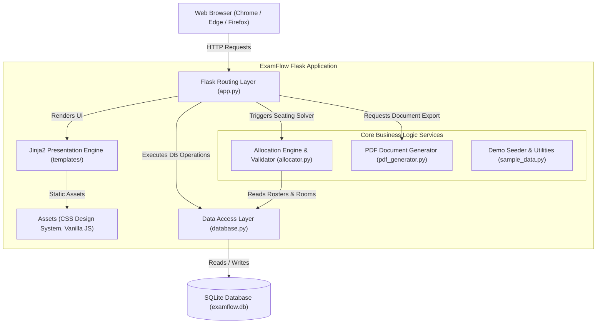
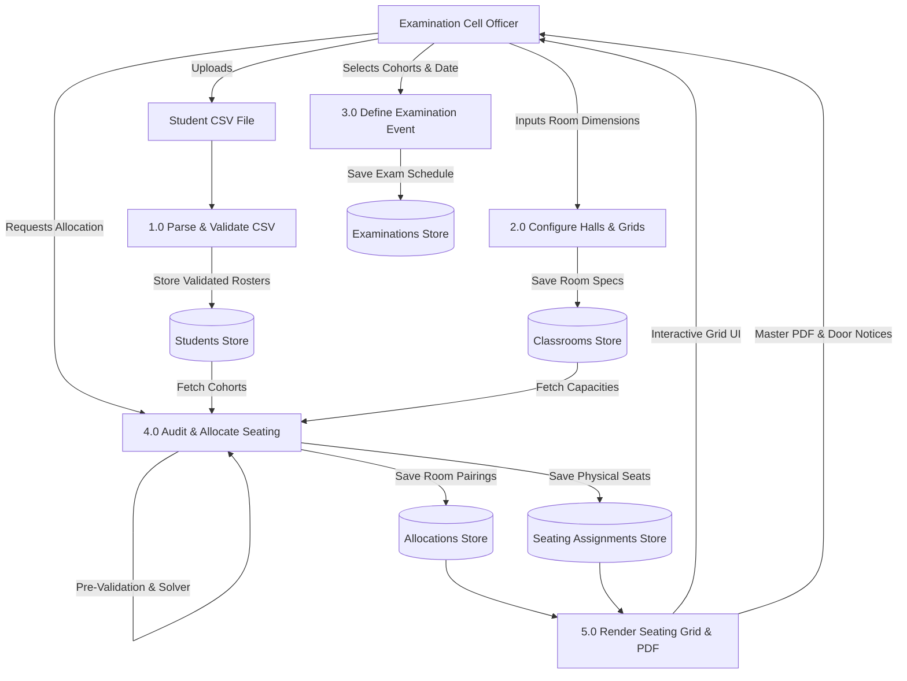
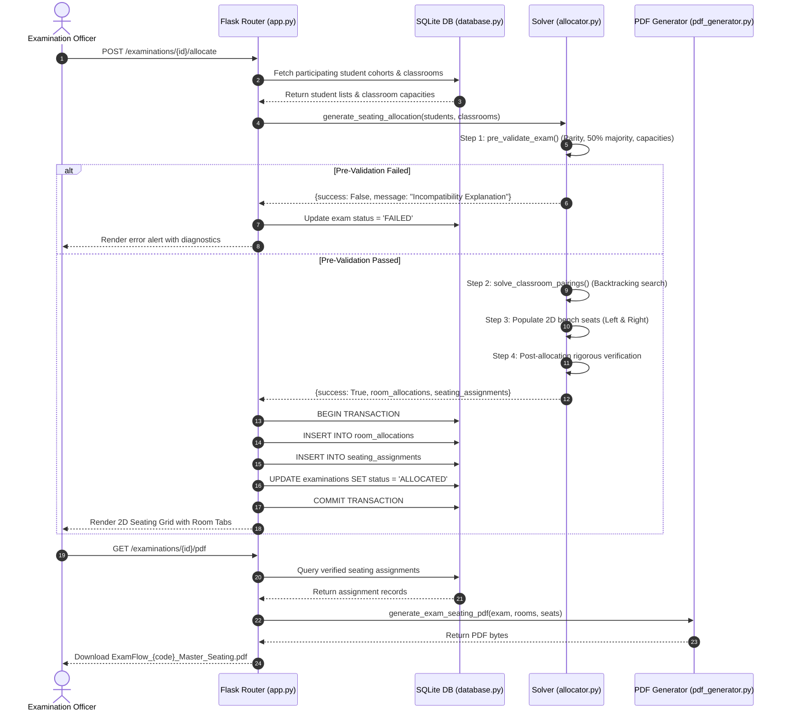
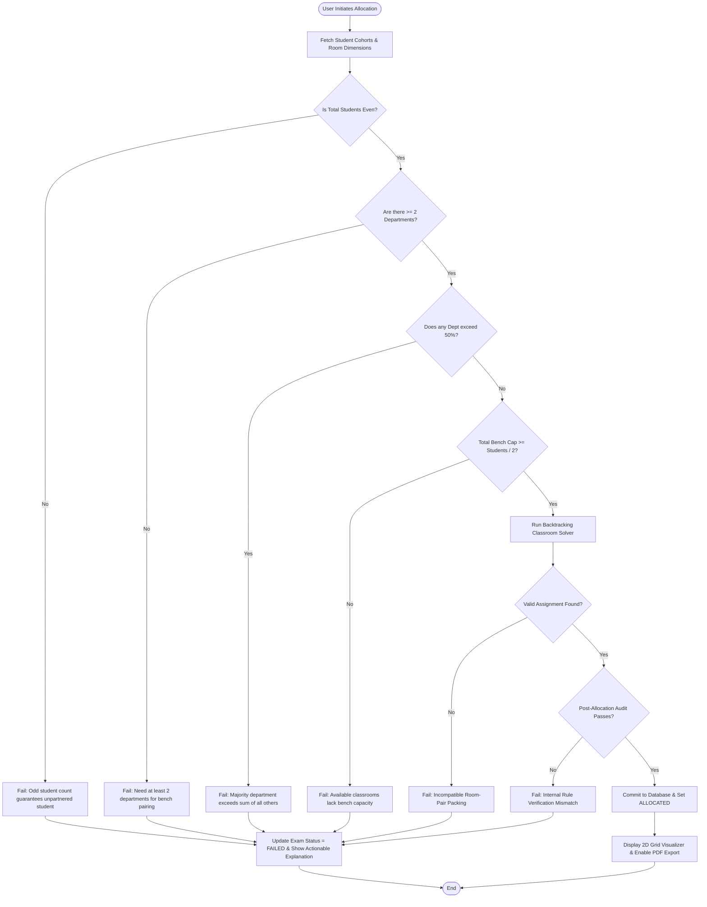
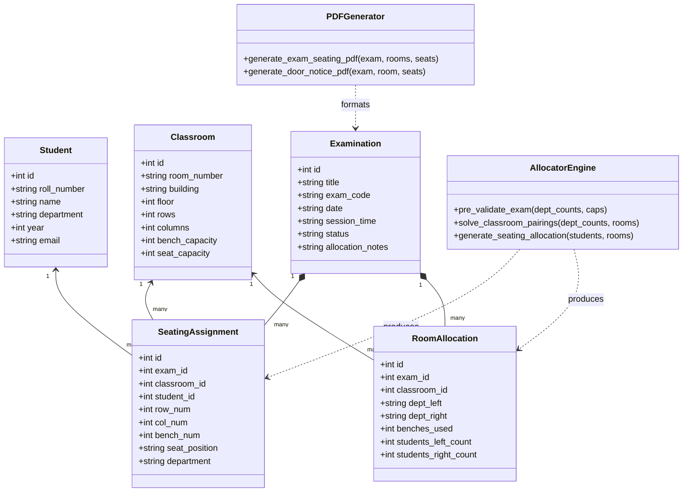

# System Design & Architecture

This document describes the high-level and detailed architectural design of ExamFlow, illustrating the workflow, data interactions, and components using standard UML and architectural diagrams.

---

## 1. System Architecture Diagram



---

## 2. Use Case Diagram

```mermaid
usecaseDiagram
    actor "Examination Controller" as Admin
    
    package "ExamFlow Core Operations" {
        usecase "View Analytics Dashboard" as UC1
        usecase "Upload Student CSV" as UC2
        usecase "Filter & Manage Students" as UC3
        usecase "Configure Classrooms" as UC4
        usecase "Schedule Examination" as UC5
        usecase "Review Mathematical Audit" as UC6
        usecase "Execute Seating Allocation" as UC7
        usecase "Visualize 2D Seating Grid" as UC8
        usecase "Download Master PDF" as UC9
        usecase "Download Room Door Notice PDF" as UC10
    }
    
    Admin --> UC1
    Admin --> UC2
    Admin --> UC3
    Admin --> UC4
    Admin --> UC5
    Admin --> UC6
    Admin --> UC7
    Admin --> UC8
    Admin --> UC9
    Admin --> UC10
```

---

## 3. Data Flow Diagram (Level 1 DFD)



---

## 4. Sequence Diagram: Allocation & Export Workflow



---

## 5. Activity Diagram: Allocation Decision Logic



---

## 6. Class Diagram


